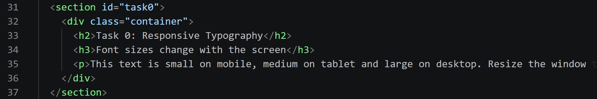
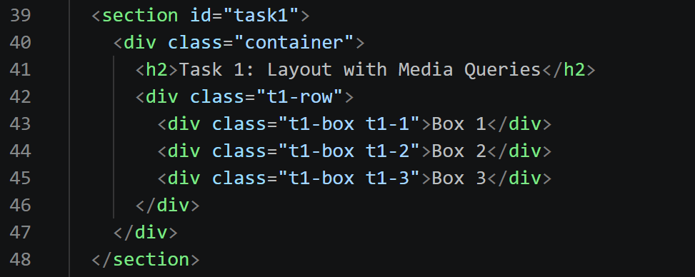
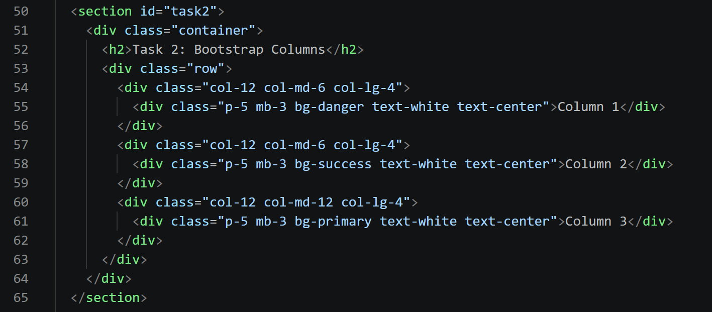
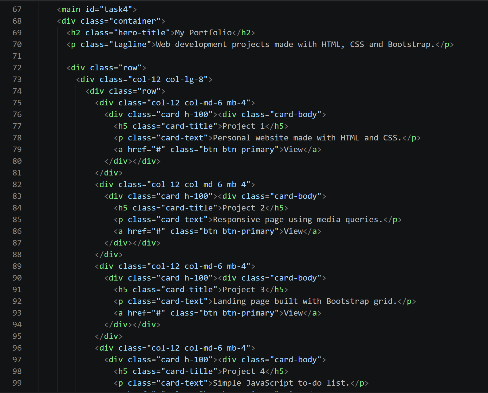
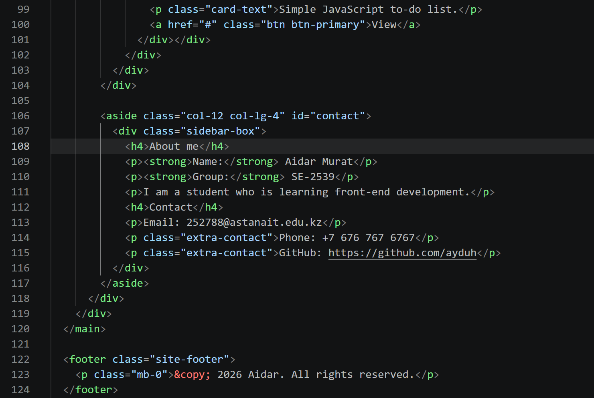

# Assignment 3: Responsive Web Design

**Name:** Aidar
**Group:** SE-2539

---

## Overview
This repository contains the implementation of Assignment #3 focusing on Responsive Web Design using CSS Media Queries and the Bootstrap 5 Grid System.

---

## Tasks Overview

### Task 0: Responsive Typography
- Used custom CSS `@media` queries (`min-width: 768px` and `min-width: 992px`) to dynamically adjust headings (`h2`, `h3`) and paragraph (`p`) font sizes depending on screen dimensions (mobile, tablet, desktop).

---

### Task 1: Responsive Layout with Media Queries
- Created a 3-box flexible container using Pure CSS Flexbox and Media Queries (without Bootstrap).
- **Desktop:** 3 boxes side-by-side (`width: 33.33%`).
- **Tablet (`max-width: 991px`):** 2 boxes per row (`width: 50%`).
- **Mobile (`max-width: 767px`):** Stacked vertically (`width: 100%`).

---

### Task 2: Bootstrap Responsive Columns
- Built a 12-column responsive layout using Bootstrap grid classes:
  - Mobile: `col-12` (stacked)
  - Tablet: `col-md-6` (2 columns on row 1, 1 column on row 2)
  - Desktop: `col-lg-4` (3 equal columns)

---

### Task 3 & 4: Responsive Navigation Bar & Portfolio Page
- Implemented a Bootstrap Navbar with a collapsible hamburger menu for mobile devices (`navbar-expand-lg`).
- Constructed a two-column main portfolio layout:
  - **Left section (`col-12 col-lg-8`):** 4 project cards arranged in a responsive nested grid.
  - **Right section (`col-12 col-lg-4`):** Sidebar containing personal details and contact links.
- Applied additional custom CSS media queries to hide non-essential elements on smaller viewports.

---

## Summary of Work Process
1. Configured the document head with proper `<meta name="viewport" content="width=device-width, initial-scale=1.0">` to ensure mobile responsiveness.
2. Structured raw layout components using pure CSS media queries for Task 0 and Task 1.
3. Integrated Bootstrap 5 CDN for grid layout, navigation bar, and component utilities.
4. Verified layout behavior across various viewports using browser Developer Tools (F12 Responsive Design Mode).